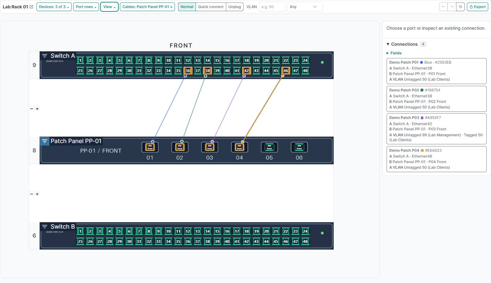
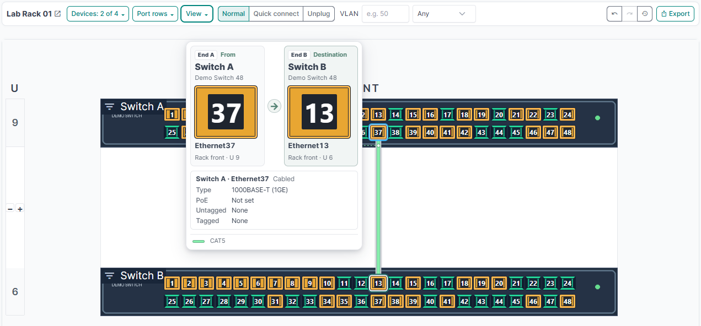

# nbCableEditor

nbCableEditor lets you design device faces and manage rack cabling directly in NetBox. Place ports on device images or custom drawings, connect and move cables in the rack view, and trace links through patch panels to wall outlets and endpoints.

Version **0.10.61** supports **NetBox 4.5.10 and later 4.5 releases** and requires **Python 3.12 or later** in the NetBox environment.

- [User guide](docs/user-guide.md)
- [Installation, upgrades, and permissions](docs/installation.md)
- [Local Docker demo](#local-docker-demo)
- [Plugin settings and template import](docs/user-guide.md#configure-the-plugin)



The device cable filter shows the patch panel's direct connections and dims occupied ports on unrelated links.

## Work with cables in a rack

Open a rack in NetBox and select **Cable Editor**. Start with **View → Rack side → Front** and **Zoom → Auto** in the toolbar. Choose which devices and port rows to show, focus on one device's cables, or use a VLAN filter to find free ports.

- [Filter devices, port rows, and cables](docs/user-guide.md#filter-devices-rows-and-cables)
- [Choose a rack side, line mode, and routing strategy](docs/user-guide.md#choose-the-rack-view)
- [Find ports by VLAN and configure port colors](docs/user-guide.md#find-ports-by-vlan)
- [Connect, trace, and edit cables](docs/user-guide.md#inspect-and-change-connections)
- [Export a rack plan to PNG or PDF](docs/user-guide.md#export-the-rack-plan)



## Design device and module layouts

Open **Layout editor** from a device type or module type. Place individual ports or arrange a range in a grid. Add custom artwork, text, or module bays, then save the layout for every instance of that type. [Design a device or module layout](docs/user-guide.md#design-a-device-or-module-layout)

Use **Import template** to start with one of 18 device or four module layouts, or upload your own image-free JSON template. Review the mappings to existing NetBox interfaces, passive ports, and module bays before applying the drawing. [Import a layout template](docs/user-guide.md#import-a-layout-template)

## Local Docker demo

The `nbcableeditor-dev` Compose stack mounts the plugin from the checkout and serves NetBox at [localhost:8096](http://localhost:8096/). The demo uses local development credentials. For concurrent demos from separate checkouts, assign each one its own Compose project name and host port.

Sign in with username **`test`** and password **`test`**. The container creates this local superuser on startup if the account does not already exist.

From the repository root, start NetBox and follow its startup logs.

```sh
docker compose -f dev/compose.yaml up -d
docker compose -f dev/compose.yaml logs -f netbox
```

When the login page is available, press **Ctrl+C** to leave the log view. Collect the static files and load the sample rack.

```sh
docker compose -f dev/compose.yaml exec netbox /opt/netbox/venv/bin/python /opt/netbox/netbox/manage.py collectstatic --no-input
docker compose -f dev/compose.yaml exec netbox sh -c "/opt/netbox/venv/bin/python /opt/netbox/netbox/manage.py shell < /plugin/dev/demo.py"
```

Open **Lab Rack 01** in NetBox and select **Cable Editor**. The rack contains two 48-port switches, **Patch Panel PP-01**, and **Modular Chassis MC-01**. The wall outlets and endpoints are in **Demo Office**, outside the rack.

| Switch A | Patch panel jack | Wall outlet | Endpoint | VLAN on the switch port |
| --- | --- | --- | --- | --- |
| Ethernet36 | P01 | WD-01 | Workstation PC-01 | Untagged 50 |
| Ethernet38 | P02 | WD-02 | Printer PR-01 | Untagged 50 |
| Ethernet42 | P03 | WD-03 | Access Point AP-01 | Tagged 50, untagged 99 |
| Ethernet46 | P04 | WD-04 | Open outlet | Untagged 50 |

- Hover over one of these switch ports to trace it. In **Normal** mode, click the cable to open the complete route. Search for VLAN `50` with **Tagged** selected to highlight the access point's switch port.
- Jacks P05 and P06 are free in a fresh demo. Select **View → Both** to connect a free switch port to the rear of the patch panel. Use **Undo** to restore the previous state.

### Try module bays and installed modules

Select **Modular Chassis MC-01** under **Devices** and choose **View → Both**. The 2U chassis shows a copper module in Bay 1, a management module in Bay 2, and an empty Bay 3. Each installed module exposes four ports on each face. The front patch cable connects `Ethernet1/4` to `Ethernet2/1`, with the remaining ports available for cabling tests. Open **Layout editor** on **Demo Modular Chassis 2U** to move a bay, or on either module type to edit its face and port positions.

To add just the chassis to an existing local demo, run the module seed from the checkout used by the Compose stack.

```sh
docker compose -f dev/compose.yaml exec netbox /opt/netbox/venv/bin/python /opt/netbox/netbox/manage.py shell -c 'from dcim.models import Rack; from dev.module_demo import seed_module_demo; seed_module_demo(Rack.objects.get(site__slug="nbcableeditor-demo", name="Lab Rack 01"))'
```

Use `docker compose -f dev/compose.yaml stop` to pause the demo and `docker compose -f dev/compose.yaml start` to resume. The stack does not configure a persistent media volume for container rebuilds.

## Run the tests

Run the plugin tests in the demo container and the JavaScript tests with local Node.js.

```sh
docker compose -f dev/compose.yaml exec netbox /opt/netbox/venv/bin/python /opt/netbox/netbox/manage.py test nbcableeditor
node --test tests/*.test.cjs
```
