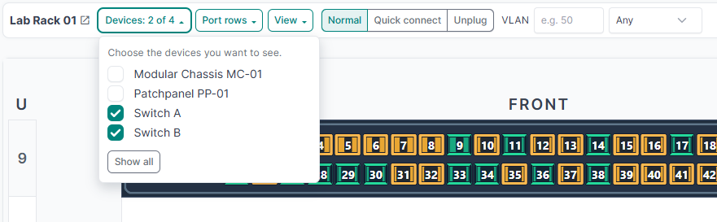
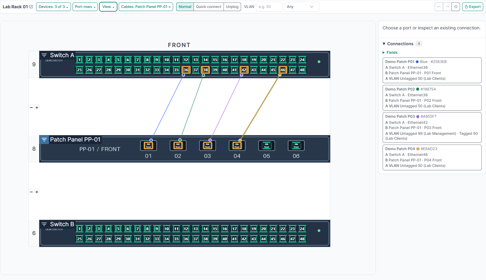
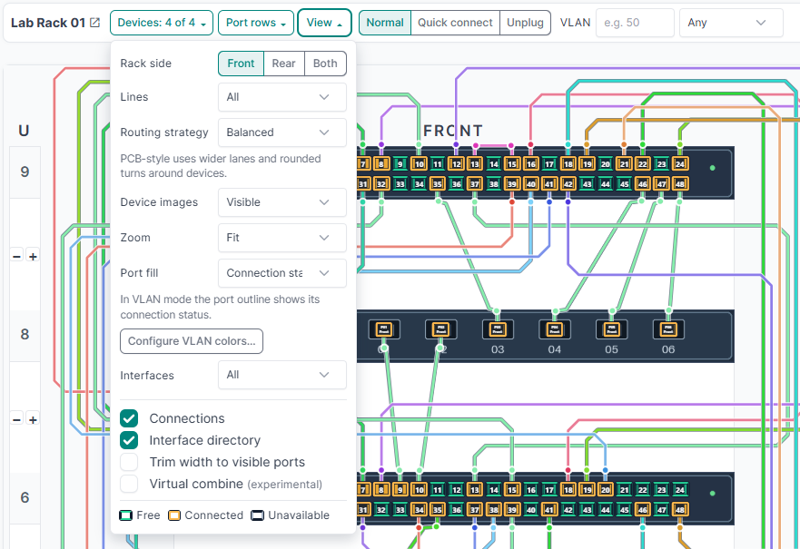
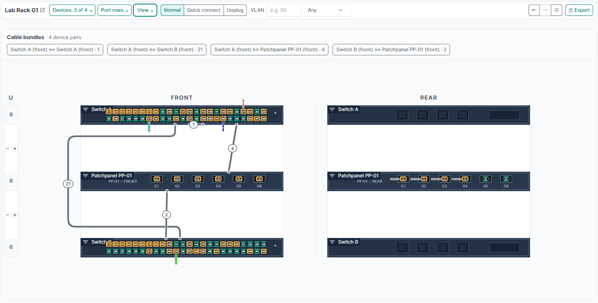
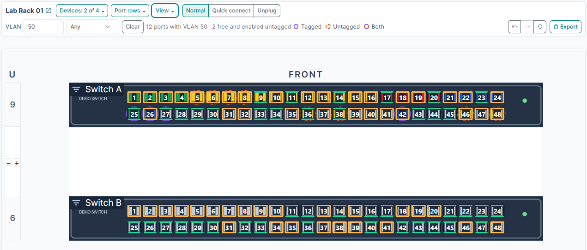
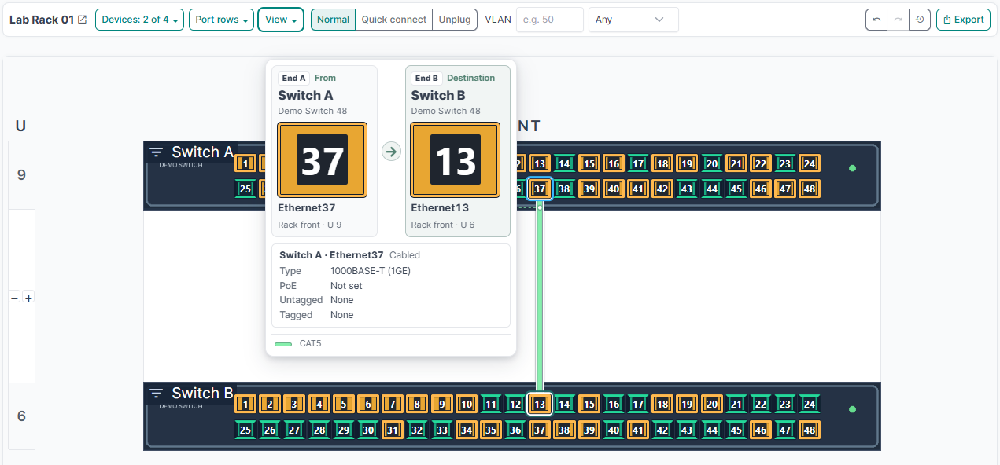
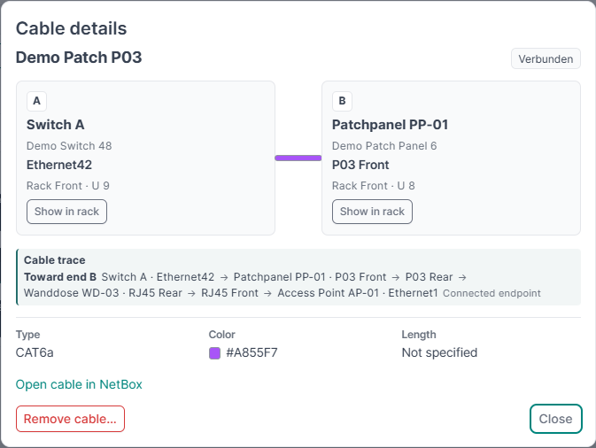
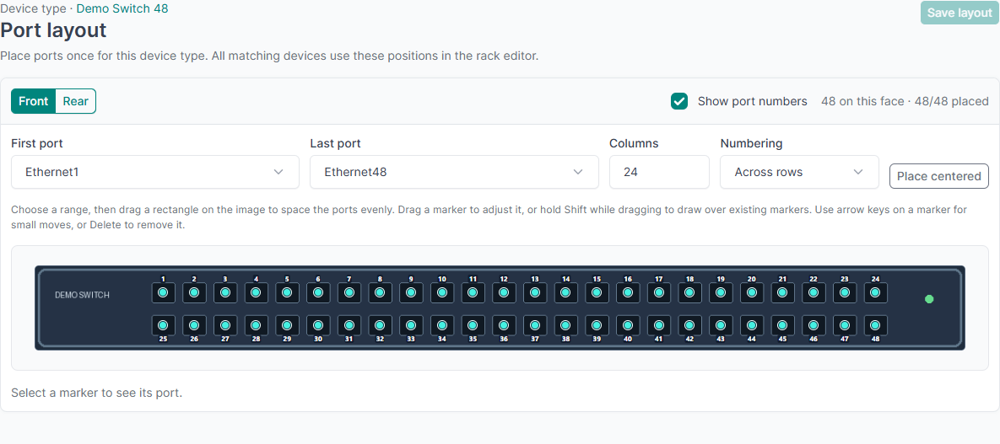

# nbCableEditor user guide

Use Cable Editor to find available ports, follow connections, and plan or record changes in NetBox. This guide uses **Lab Rack 01** from the [local Docker demo](../README.md#local-docker-demo). The same controls apply to other racks.

- [Open the editor](#open-the-editor)
- [Filter devices, rows, and cables](#filter-devices-rows-and-cables)
- [Choose the rack view](#choose-the-rack-view)
- [Save and switch rack views](#save-and-switch-rack-views)
- [Choose which connections to draw](#choose-which-connections-to-draw)
- [My Rack list](#my-rack-list)
- [Find ports by VLAN](#find-ports-by-vlan)
- [Inspect and change connections](#inspect-and-change-connections)
- [Export the rack plan](#export-the-rack-plan)
- [Design a device or module layout](#design-a-device-or-module-layout)
- [Saved settings and troubleshooting](#saved-settings-and-troubleshooting)

## Open the editor

1. Open a rack in NetBox and select **Cable Editor**.
2. Start with **View → Rack side → Front** and **Zoom → Auto** to see as much of the front elevation as the workspace allows. Select **Rear** for rear-mounted ports or **Both** to work across the two sides.
3. Hover a port to identify it. Green double lines indicate a free port, an amber frame indicates a connected port, and a gray frame indicates an unavailable port. A VLAN fill can change the color inside the frame.

Available devices, ports, and actions depend on your [NetBox permissions](installation.md#permissions). A device can appear in the **Interface directory** even when its ports have no positions on the elevation.

When a mounted device type has no saved layout, the elevation shows **Missing devicetype layout**. Its ports use their NetBox names in a grid of up to 24 columns, and cables end at the matching grid ports. The grid is an approximation for the rack display.

## Filter devices, rows, and cables

| Control | What it changes | How to clear it |
| --- | --- | --- |
| **Devices** | Tick one or more devices to show those devices and their ports. With no device selected, the rack shows all devices. | Select **Show all**. |
| **Port rows** | Tick rows to show their ports on the elevation. The menu groups rows by device and rack side. **Only** keeps that row visible for its device and side. | Tick individual rows again or select **All rows**. |
| Filter icon beside a device name | Focuses cable display on direct connections to or from that device. Unrelated occupied ports are dimmed so the matching endpoints and free ports stand out. | Select the **Cables** chip in the toolbar. |
| **VLAN** | Highlights matching ports on the rack and narrows the side lists to VLAN matches. | Select **Clear** beside the VLAN selector. |
| **Interface directory → Search devices or interfaces** | Narrows the directory by device, port name, label, description, or cable peer. **Only ports outside the elevations** narrows it to ports that have no marker in the current elevations. | Clear the search and uncheck the option. |

**To inspect the PP-01 patch panel**, click its filter icon while keeping its peer devices visible. Use **Devices** to narrow the drawing further, then hover a connected port to identify the peer. A peer outside the current view can still appear in the tooltip when its details are available.

Device cable focus narrows the connection display to the selected device. Clear the **Cables** chip to work across devices again. To find a missing port, check the rack side, **Devices**, and **Port rows** first. Use the directory to find ports without a placed marker.

## Choose the rack view

Open **View** in the rack toolbar. The table shows the built-in defaults. Your NetBox administrator can set different starting values.

| Setting | Default | When to change it |
| --- | --- | --- |
| **Rack side** | **Front** | Choose **Rear** for rear patch ports or **Both** to see both elevations side by side. |
| **Lines** | **All** | Choose **Bundles** for an overview by device pair, **Selected only** for a hand-picked set, **Filtered connections only** for connections that match your rules, or **Hidden** to hide persistent cable lines. |
| **Routing strategy** | **Balanced** | Choose **PCB-style** for wider lanes and rounded turns. Expanded cable bundles use PCB-style automatically. |
| **Device images** | **Visible** | Use **50% opacity** or **Hidden** when the image makes ports or cables hard to see. Ports remain interactive. Press **I** while dragging a cable to cycle the image mode. |
| **Port fill** | **Connection status** | Choose **Untagged VLAN** to color the port interior by VLAN and read connection status from the outline. |
| **Interfaces** | **All** | Choose **Highlight Free** or **Highlight Used** to emphasize ports by connection status. |
| **Connections** and **Interface directory** | Both visible | Hide either panel in **View** to simplify the workspace. Hide both for more drawing space. |
| **Trim width to visible ports** | Off | Crop the unused left and right margins to a shared width based on the visible port positions. |
| **Virtual combine** | Off | Try narrow sleeves for runs of at least three cables between adjacent ports connected in the same order. |
| **Compact empty rack units** | Off | Show each run of three or more unused rack units as a two-unit break labeled with its actual range, such as 7–15. |
| **Position indicator** | On | Show the rack overview on desktop when the elevation can scroll vertically. |

Use **+**, **−**, or the **Zoom** selector in the lower-right corner of the rack drawing. **Auto** fits the available width and height. **Horizontal Fit** and **Vertical Fit** fit one dimension. The **100%** setting now uses the size previously labeled **175%**. Existing views keep their physical zoom sizes.

- Use the **mouse wheel** to scroll vertically. Select **Pan rack** to drag the drawing from anywhere, or use the arrow keys on the Pan button. Press **Esc** to exit Pan mode. Dragging empty space and using the middle mouse button also pans the rack.
- On a touch screen, **pinch with two fingers** to zoom around their midpoint. Drag empty space with one finger to pan, or start on a port to connect or move a cable.
- The zoom selector shows your custom percentage. Choose a preset to return to a fit or fixed zoom.

On desktop, the position indicator shows a miniature of the current rack elevation, including the selected sides, unit spacing, and visible device artwork. It shows compacted ranges at their full physical height. The outline marks the current viewport. Drag the outline to scroll or select a device to jump to it. Toggle **View → Position indicator** for the current rack view.

### Read dense wiring

- Choose **Lines → Bundles** to see cable counts grouped by device pair and rack side. Select a bundle in the drawing or in the **Cable bundles** panel to expand it. Select **Show all bundles** to return to the overview.
- Use the small **+** and **−** controls between devices to adjust the display gap and make room for cable lanes. The rack positions in NetBox stay the same.
- Enable **Virtual combine** to group eligible vertical or horizontal runs into slim sleeves. Long runs use compact branches and can get additional room around the elevations. Each uninterrupted row is evaluated separately, so a two-row switch can show one sleeve per row. Hover a sleeve to reveal all member cables inside its outline. Hover an individual cable or connected port to follow that link.

## Save and switch rack views

1. Set up the rack as you want your team to see it. A saved view includes the rack side, zoom, spacing and compaction of rack units, devices and port rows, line and routing settings, VLAN search and colors, sidebar settings, and the position indicator. Manual cable selections and the ordered interface, connection, and device rules are also saved.
2. Select **Manage views…**, enter a name, and choose **Save as new view**. Use the toolbar's view selector to switch views. Choose **Personal view** to return to your browser preferences.
3. With a saved view active, use **Manage views… → Save changes** to update its settings or name. Use **Delete view…** to remove it for everyone.
4. Select **Set rack default** to make that view the starting point for the rack. A link to a specific saved view opens that view directly. To remove the default, select **Clear rack default**.

Open **Toolbar controls** in **Manage views…** to choose the controls shown with that view. For example, apply a device or VLAN filter, then hide its control before saving. The saved filter still applies. Use the view selector to return to **Personal view** or switch to another saved view. The toolbar choices are limited to features enabled in the plugin settings.

In **Manage views… → Reset personal view**, choose **Use system defaults** or **Use rack default** to clear this rack’s personal settings in your browser. Your choice applies when you reopen the rack. **Use rack default** is available when a shared default has been set. In a personal view, **View → Use global defaults** also resets to system defaults.

Everyone who can view the rack can use its saved views and reset their personal view. Changing shared views requires NetBox **Change** permission on the rack. The devices, cables, and VLANs shown still depend on each viewer's object permissions.

To reuse a view across racks, configure it in a representative rack and open **Manage views… → Open in global view designer…**. The designer is also available under **Cable Editor → Global rack views**. Choose **All racks** or select sites, racks, rack roles, or rack tags. A rack qualifies when it matches at least one selected item in any category. **Rack preview** lists the qualifying racks you can view. Save the global view to make it available in each qualifying rack's view selector.

Enable **Show in toolbar** to add a quick-selection button on matching racks. The active view is highlighted in the button group. Enable **Is default** to use the view when a matching rack opens without an explicit view selection or a rack-specific default. If several global defaults match, the first by name is used.

In the global designer, use **Connection Rules…**, **Interface Rules…**, and **Device Rules…** to define the view's ordered rules. Each rule combines conditions with actions. Select a **Preview rack** to test the draft with **Preview in rack**, then select **Save global view** to use it across the selected racks.

## Choose which connections to draw

- With **Lines → Selected only**, select **Choose connections…**, tick the cables you want to keep visible, and apply the selection. Search by cable, device, or port to find cables in a large rack. You can also add or remove individual cables from their context menu.
- Open **Connection Rules…** to match either endpoint or a pair of endpoints, VLAN membership, cable type, length in metres, or where the cable goes. Location conditions can match connections within the rack, with one end outside, to another rack or site, or to specified racks or sites. Endpoint conditions can use the device, type, manufacturer, role, tags, and the module, module type, manufacturer, and tags.
- Open **Interface Rules…** to match VLAN settings, individual interfaces or interface ranges on specific devices, device and module metadata, and cable traces. **Device Rules…** uses the device's metadata and its interfaces, modules, and traces.
- All three editors have **Preview in rack**. Use **Back to rules** to continue editing or **Cancel preview** to leave the preview. Apply the rules and save the rack view to share them with the team.

### Ordered rules and actions

Add a rule, give it a name, and use **Edit conditions** to choose its scope. Combine conditions with **All conditions (AND)** or **Any condition (OR)** and nested groups. **NOT** inverts a condition or group. A rule with empty conditions matches every item in its category.

Use the up and down buttons to change the order. Enabled rules run from top to bottom. Each matching rule applies its selected actions, with later matching actions taking precedence. **Unchanged** preserves the earlier value. **Halt after this rule** stops evaluation for each item that matches the rule. Disable a rule to skip it while keeping its settings.

| Rule editor | Available actions |
| --- | --- |
| **Interface Rules** | Show or hide the port, color the port, display a red X or green checkmark, place a colored circle or rectangle outside the port, hide the port number, choose the label's font weight, color the label, allow or prevent editing, enable or disable connecting and disconnecting, hide an attached cable, and show a virtual cable at an unconnected port. |
| **Connection Rules** | Allow or prevent editing and virtual pipes, enable or disable hover and the details dialog, show or hide the cable, and set cable color, luminosity, opacity, line style, and width. |
| **Device Rules** | Allow or prevent editing, display a gray box, show or hide interfaces and cables, and show or hide the device on the front and rear elevations. |

For a view that shows only selected ports, put a rule that hides all ports first, then a rule that shows matching ports. Cable visibility has its own actions. A virtual cable at a free interface is a visual aid. Connecting and disconnecting also require the user's NetBox permissions.

The rule lists are stored in personal, rack, global, and shared cable views. Existing connection and port filters are imported when editing their rule lists.

Turn on **View → Show external cable locations** to route visible cables that leave the rack to small badges labeled with the location name. The badges sit at least one displayed rack unit beyond the outer edge of the elevation. Cables to the same location share a badge, and the editor chooses its side and height based on the estimated combined cable length. Hover over or focus a badge to see its site and the readable devices and ports reached by its cables. The editor uses the peer rack or site when a location is unavailable. A badge disappears when its last visible cable is filtered out.

Use the **Show cable traces** options in **View** to draw the cable path to its destination.

- **Show cable traces to other racks** groups paths by the destination rack.
- **Show cable traces to other locations** groups paths by the destination location.
- **Show cable traces to other sites** groups paths by the destination site.
- **Show cable traces to not racked devices** shows the destination devices that have no rack assignment.

When a path crosses a mapped patch panel, the outgoing leg begins at the mapped port. A dashed line joins the ports when both cable legs are visible. Select **Both** rack sides to see ports on opposite faces. Hover over or focus a badge to see its type and the reachable devices and ports.

When destination displays are off, external cables end in a filled dot above or below the device. All destination displays are off by default and can be saved with a view. **Rack features** controls their availability, and **View defaults** sets the starting values.

Use **NOT** on a condition to invert that condition, or on a group to invert the combined AND or OR result. This also works on the top-level group. Without any conditions, a rule applies its actions to all items. Empty groups have no effect on the condition result, even with **NOT** enabled.

For example, add a **Between endpoints** condition with a device type on one side and one or more devices on the other. Add a **VLAN membership** condition for **Untagged**, and choose **All conditions (AND)**. Each endpoint can also specify port names or ranges such as `1/1/1-12`. To allow multiple alternatives, add a group using **Any condition (OR)** and put one condition per alternative inside it.

To include a device behind a patch panel, add a **Cable trace** condition, choose **Any device along the trace**, and select the wall outlet under **Device types**. **Next device along the trace** checks the nearest other device in each relevant direction, including across mapped patch-panel ports. Use the same condition in **Interface Rules** to show, mark, or restrict ports according to what their trace reaches. Trace matches use the parts of the path that your NetBox permissions let you follow.

Choose **Trace ends** to check the actual ends of the path. You can match ends inside or outside the current rack, location, or site, or select specific destinations from the NetBox inventory you can view. Choose **Trace runs through** to also match intermediate devices, including racks in selected locations. To find paths that pass through a rack and end elsewhere, combine **Trace runs through selected racks** with a negated **Trace ends in selected racks** condition for the same rack.

## My Rack list

Open **Cable Editor → My Rack list** to keep personal quick links to racks. Search by rack name or narrow the catalog by location, site, status, tenant, rack role, tag, device count, height, and site group. Add individual racks or add the filtered matches together.

For each favorite, choose the rack default, your personal view, or an available saved rack or global view. Click the rack name to open the editor in that view. Your list is stored with your NetBox account and only shows racks you can view.

## Configure the plugin

Open **Cable Editor → Settings** in the NetBox sidebar, or **View → Plugin settings** inside a rack. This page requires [permission to change the plugin settings](installation.md#permissions).

- **Rack features** enables tools and controls across all racks. You can turn off VLAN functions, device and port-row filters, the position indicator, rack planning, the Cable Calculator, export, saved views, and other controls independently. When rack side selection is off, the editor shows the front elevation. When the routing strategy selector is off, the rack uses the strategy in **View defaults**.
- **Default rack toolbar** chooses the controls shown by default. A saved view can choose a different set from the features enabled globally.
- **View defaults** sets the rack side, zoom, line mode, routing strategy, device images, port fill and highlighting, and which view options start enabled. Browser preferences override these starting values.
- **Drawing** sets the target spacing between cables, devices and virtual tubes, and the starting gap and **+** / **−** step between devices. The router adapts its path to the space available.
- **Ports and hover** sets the maximum port contour width and optional widths for free, connected and unavailable ports. Port contours scale down on small markers. The hover delay is set in milliseconds.
- **Displayed fields** sets the starting columns in the Interface Directory and Connections and the fields shown on opening Cable Details and Port Details. Editable fields can still be reached through the corresponding **More properties** section. Select visible NetBox Cable custom fields here to show their values in Cable Details.

Save the settings and reload the rack to see the changes.

### Review built-in templates for existing device types

Open **Cable Editor → Layout template import**. Search by manufacturer, model or part number. The overview suggests a built-in template when it finds an unambiguous part number or model match. You can also select another template manually and preview the available faces.

Choose **Review mapping** to open the designer with that template. Check the mapping to your interface names, front and rear ports and module bays. If a layout already exists, check the replacement options before applying. Finish with **Save layout** in the designer.

## Find ports by VLAN

1. Enter a VLAN ID from **1** to **4094** in the toolbar, for example `50`.
2. Choose **Any**, **Tagged**, or **Untagged**. Tagged matches VLANs explicitly assigned to the port. The drawing marks matching ports, **Interface directory** lists those ports, and **Connections** lists cables with a matching endpoint in scope. In **All** line mode, the ordinary cable lines stay visible.
3. To find a place to connect a client, choose **Untagged** and look for a free, enabled match. The status beside the filter shows the count. **View → Interfaces → Highlight Free** makes free ports easier to pick out.
4. Hover or double-click a candidate to check its VLAN assignments, interface type, and PoE details. The editor displays the assignments recorded in NetBox.

### Set VLAN colors

Use **View → Port fill → Untagged VLAN**, then **Configure VLAN colors…**. Add a rule with a single ID, a comma-separated list such as `50,60,70`, or a range such as `50-70`. Choose the color and save. The first matching rule wins, followed by the VLAN's **Cable Editor color** and then the optional fallback. Ports without an untagged VLAN use a neutral fill. [Configure VLAN colors](installation.md#configure-vlan-colors)

VLAN color rules affect the port fill. Save them in a rack view to share them. Use the VLAN search to highlight tagged membership. To change a port's VLAN assignment, edit the interface in NetBox.

## Inspect and change connections

### Follow a port or cable

Hover a connected port to read **From → Destination**, with the hovered port first. When you hover a cable, its nearer end comes first. Both cards show the enlarged port label and keep their physical **End A** and **End B** identifiers. When the path continues through a patch panel, the arrow shows the immediate peer and the trace below shows the further destination, if visible to your account.

On desktop viewports at least 1,280 CSS pixels wide, cable and port tooltips keep at least 100 pixels of clearance when space allows. A dotted guide links the tooltip to the cable or port in the drawing.

- Click or hover a **Connections** entry to highlight its cable in the drawing. The list shows endpoints and color. Use **Fields** to add details such as VLANs, type, status, and length.
- Search **Connections** by cable label, exact ID such as `#5`, device, port, or any readable stop along the trace. Combine terms such as `Switch A WD-01` to narrow the list. A **Trace match** shows where a result was found along the route. The search combines with the current device and VLAN filters and affects the list only. Press **Esc** in the field to clear it.
- Use **Interface directory** for ports on or outside the elevations. It shows the connected peer and cable color when available. Use **Fields** to add peer VLANs, label, type, or description.
- Double-click a port or use **Port details** from its context menu to see port metadata and links to the native NetBox port, device, and connection. With change permission, you can edit the label and tags.
- Click a cable to open its details. A trace can follow NetBox front-to-rear mappings through a patch panel and a wall outlet. A stop marked **Unpatched** indicates an open end. With change permission, edit cable color, length, label, description, tags, and comments in the dialog. Text fields save on blur or **Enter**, comments save with **Ctrl+Enter**, and color and tag changes save when selected.
- Use the cable's right-click menu and choose **Edit cable…** to change its type or status.
- Choose **Copy cable link** in Cable Details or from the cable's right-click menu. The link opens the saved snapshot of the current view with that cable selected. The recipient needs NetBox permission to see the rack and cable.

### Connect, move, or remove cables

| Task | Steps |
| --- | --- |
| Connect two ports | In **Normal** mode, drag from a free port to a free target. Choose cable type, color, label, and optionally a length and unit. The dialog prefills the last saved type and color. Press **Enter** to confirm. |
| Connect outside the view | Double-click a free port and choose **Manual Connect**. NetBox opens its native cable form with side A preselected. Search for the destination on side B, including devices outside the rack, then save or cancel to return to the editor. |
| Move one end | Drag the connected port or its cable handle onto a free target and confirm. The existing cable keeps its ID and metadata. |
| Remove a connection | Open the cable details and choose **Remove cable…**, or use the cable's right-click menu. |
| Change several connections | Select **Quick connect** and click a source followed by a highlighted target to stage each pair, or select **Unplug** and click connected ports to stage removals. Choose **Apply batch** to save or **Discard** to clear the queue. |
| Restore earlier changes | Use **Undo**, **Redo**, or choose a checkpoint in **History**. History covers cable changes saved through Cable Editor and is scoped to your account and rack. A concurrent change to the same cable or a change in your permissions can prevent a restore. If a jump exceeds 500 cable changes, choose a closer checkpoint first. |

The editor draws and directly edits one-to-one cables between interfaces, front ports, and rear ports in the same rack. NetBox permissions govern which actions are available.

## Plan rack wiring

1. Open **Plans** in the rack toolbar and create a named draft. Choose a calculator profile. Its settings and the current standard length catalog are copied into the draft.
2. Choose **Inventory + plan** to see the draft over the existing cables. Use the opacity slider to dim inventory lines. **Plan only** displays new and moved connections at their proposed ports. **Inventory** returns to live cable editing.
3. In a plan view, drag from a free port to a destination to stage a cable. Drag from a connected port to stage a move. You can also select the source and destination in turn. For an unplug, select a port, open **Port actions**, and choose **Plan unplug**. The editor marks ports that become free only in the plan.
4. Open **Changes** to check the old and new endpoints, edit a new cable, or remove a proposed change. You can stage a move to a currently occupied port and resolve it with another move or unplug before applying.
5. Open **Review & apply** to see all changes, unresolved conflicts, and length warnings. Choose **Planned**, or **Connected** if the work has already been performed. Confirm a standard or manual length on each new cable you want to record. Applying the draft creates one entry in **History** for undo and redo. Moved cables keep their NetBox IDs and existing metadata.

Plans belong to the rack and are shared with users who have access. Drafts can be renamed, duplicated, and deleted. Use **New draft from profile** on an applied plan to reuse its calculator settings and catalog. Deleting an applied plan removes its planning record. Use **History** to revert the cabling itself.

Grant users the relevant **Rack Cable Plan** object permissions in NetBox alongside their rack, device, port, and cable permissions. Updating rack measurements requires permission to change the rack. Plans support simple cables between interfaces, front ports, and rear ports on devices in the same rack.

### Size cables and prepare a shopping list

Open **Cable calculator** in the rack toolbar. Select **Inventory** or the active plan and choose **Detailed lengths** or **Bill of materials**. The detail view shows the endpoints, route, physical distance, connector allowance, bends, reserve, minimum length, and recommended standard size. Inventory also shows the recorded NetBox length and flags cables that are too short, potentially replaceable with shorter ones, or need review.

The plan's bill of materials counts new cables. Review the length of a cable you intend to move. To plan a replacement, stage an unplug for the existing cable and add a new one. **Download CSV** exports the same results as the selected view. Reports use readable physical cable segments, including individual segments through a patch panel. Filters, zoom, trim, and displayed routing leave the report unchanged.

Use **Plans → Rack measurements** to enter measured panel width, front-to-rear rail depth, or channel offsets. Missing port placements produce a conservative estimate with a review note. A front-to-rear cable needs the rail depth, and an unmounted endpoint needs a manual measurement.

Use **Cable Editor → Settings → Cable Calculator** to manage routing profiles and standard cable lengths by NetBox type. The default CAT profile allows 15% reserve, 40 mm of connector lead per end, a 30 mm bend radius, and a 50 mm offset on each side. It prefers a direct connection on the same rack face when eligible. Under **Plans**, adjust an individual draft's copied routing profile for a specific installation.

The calculator uses 44.45 mm per rack unit, the rack's mounting width, and the placed device and module ports. It mirrors rear port coordinates before comparing sides. **Prefer side channel** can accept a longer route within the profile's extra-distance limit, while **Always use a side channel** requires channel routing. For a half-depth device port on the opposite side of its mounting face, measure the actual cable path. [NetBox rack dimensions](https://netbox.readthedocs.io/en/stable/models/dcim/rack/) · [Rack unit dimensions](https://iportal2.schneider-electric.com/Contents/docs/UPS-MLAN-6ZNQET_R1_EN.pdf)

## Export the rack plan

1. Set the rack sides, devices, rows, and line mode you want to include. If you want individual links in the plan, choose **All** or expand the bundle before exporting.
2. Select **Export**. For **PNG image**, choose the longest side or enter a custom value from 320 to 15,000 pixels. The whole drawing is exported at its current aspect ratio.
3. For **Print / Save as PDF**, choose A5 through A0, Letter or Legal, then select portrait or landscape orientation. Enable **Include cable list** to list the drawn cables or bundles that match the current **Connections** filters. The list is grouped by endpoint devices, with reference numbers linking the rows to the plan. Choose your printer or **Save as PDF** in the browser print dialog.
4. Under **Rack details**, select the Location, Rack ID, Rack URL, or Cable Editor URL to add them to the PNG or PDF. Enable **Include QR codes for selected URLs** to add a scannable code for each selected link.

The print layout spaces routes more widely than the on-screen drawing. Use the preview to check that the rack and cable list fit the chosen page size.

## Design a device or module layout

1. Create the port templates on the NetBox **Device Type** or **Module Type**. Use **Front Port Templates** and **Rear Port Templates** for passive jacks. Open **Layout editor** and choose **Front** or **Rear**.
2. Use **Use type image** to choose the background on each face. Add custom artwork with **Text** or **Rectangle**. Set font, size, and color. A rectangle can have a fill and a label integrated in its frame or centered within it.
3. Use **Single port** to place one port. For a range, select **Port grid**, choose the **First port** and **Last port**, then set the row and column counts and labels. Under **Port order**, choose one of the eight numbered diagrams. Each starting corner supports placement across rows or along columns. The arrow indicates the direction within a row or column, and the dashed line leads to the start of the next one. Drag the grid onto the drawing or use **Place centered**. For example, 48 ports can use 2 rows and 24 columns. **Displayed port label** sets the rack label for all instances of the type.
4. Use **Field → Insert** to add a device, module, or accessible custom field to a text item or rectangle label. The preview uses sample values. The rack renders the actual values available to the viewer.
5. Draw a **Module bay** region for a bay template on a device type. An installed module's artwork and ports appear in that region. For module type images, add NetBox image attachments named `Front` and `Rear`.
6. Choose **Save layout** to apply the design to instances of that type. Unplaced ports remain accessible from the directory.

Use **Select** to drag a selection box. Hold **Shift** to extend the selection or **Ctrl**/**⌘**-click to toggle individual ports. Use **Align** for a row, column, or grid, and **Snap → Grid** or **Objects** for alignment guides. Hold **Alt** while dragging to bypass snapping. **Undo** and **Redo** cover both faces of the current editing session.

### Import a layout template

1. Open **Layout editor → Import template** on the device type or module type. Choose a built-in template or open a **JSON file** for the corresponding type. Select **Front** or **Rear** when the file includes both faces.
2. Review the mapping. By default, slot `24` matches a port of the same kind named `24`, then falls back to a matching label. For names such as `Ethernet24` or `1/1/24`, enter `Ethernet{port}` or `1/1/{port}` in the name pattern field and choose **Remap**. On a patch panel, the front and rear slots map to NetBox **Front Port Templates** and **Rear Port Templates**, respectively. Correct any missing or ambiguous matches using the selectors.
3. For a 5406R, map the front slots **A–F** and the rear slots **PSU1** and **PSU2** to your NetBox **Module Bay Templates**. Matching bay names are selected automatically. Installed line cards use their Module Type's front layout. The J9829A power supply uses its rear layout.
4. Choose **Apply to canvas**. The selected face uses the template artwork with its image disabled. The import moves mapped interfaces and bays to their slots and keeps other placements. Use **Undo** to revert the import or **Save layout** to keep it.

#### Built-in templates

Each JSON file contains front and rear artwork and links to the hardware references. Check the product number when similar models have different ports or power configurations.

| Template | Product number |
| --- | --- |
| [Aruba 2530-24-PoE+-2SFP](../nbcableeditor/static/nbcableeditor/layout-templates/aruba-2530-24-poe-2sfp.json) | J9779A |
| [Aruba 2540 48G 4SFP+](../nbcableeditor/static/nbcableeditor/layout-templates/aruba-2540-48g-4sfp-plus.json) | JL355A |
| [Aruba 2920-24G](../nbcableeditor/static/nbcableeditor/layout-templates/aruba-2920-24g.json) | J9726A |
| [Aruba 2920-48G](../nbcableeditor/static/nbcableeditor/layout-templates/aruba-2920-48g.json) | J9728A |
| [Aruba 2930F-24G-PoE+-4SFP+](../nbcableeditor/static/nbcableeditor/layout-templates/aruba-2930f-24g-poe-4sfp-plus.json) | JL255A |
| [Aruba 2930F-48G-4SFP+](../nbcableeditor/static/nbcableeditor/layout-templates/aruba-2930f-48g-4sfp-plus.json) | JL254A |
| [Aruba 5406R zl2 J9821A](../nbcableeditor/static/nbcableeditor/layout-templates/aruba-5406r-zl2-j9821a.json) | J9821A switch kit |
| [Aruba 5406R zl2 J9850A](../nbcableeditor/static/nbcableeditor/layout-templates/aruba-5406r-zl2-j9850a.json) | J9850A base chassis |
| [Aruba 6000-12G-POE4-2SFP](../nbcableeditor/static/nbcableeditor/layout-templates/aruba-6000-12g-poe4-2sfp.json) | R8N89A, with two additional gigabit copper ports |
| [Aruba 6100-48G-4SFP+](../nbcableeditor/static/nbcableeditor/layout-templates/aruba-6100-48g-4sfp-plus.json) | JL676A |
| [Aruba 6100-48G-POE4-4SFP+](../nbcableeditor/static/nbcableeditor/layout-templates/aruba-6100-48g-poe4-4sfp-plus.json) | JL675A, 370 W PoE budget |
| [Aruba 8320-48XF6Q](../nbcableeditor/static/nbcableeditor/layout-templates/aruba-8320-48xf6q.json) | JL479A |
| [ProCurve 2810-48G](../nbcableeditor/static/nbcableeditor/layout-templates/procurve-2810-48g.json) | J9022A |
| [24 Port Unmanaged Switch](../nbcableeditor/static/nbcableeditor/layout-templates/generic-24-port-unmanaged-switch.json) | Generic, 24 interfaces |
| [24-port UTP Patch Panel](../nbcableeditor/static/nbcableeditor/layout-templates/generic-24-port-utp-patch-panel.json) | Generic, 24 pass-through positions |
| [LC-12-port Fiber Patch Panel](../nbcableeditor/static/nbcableeditor/layout-templates/generic-lc-12-port-fiber-patch-panel.json) | Generic, 12 pass-through positions |
| [LC-24-port Fiber Patch Panel](../nbcableeditor/static/nbcableeditor/layout-templates/generic-lc-24-port-fiber-patch-panel.json) | Generic, 24 pass-through positions |
| [SC-24-double-port Fiber Patch Panel](../nbcableeditor/static/nbcableeditor/layout-templates/generic-sc-24-double-port-fiber-patch-panel.json) | Generic, 24 duplex adapters |

The 2920 and 2810 use shared logical port numbers for their dual-personality connectors. Each logical port has one assignable position at the copper connector. The alternate SFP cages are drawn as artwork.

The SC schematic uses one logical slot for each pair of openings. To trace across any patch panel, configure the front-to-rear port mappings in NetBox.

| Module template | Visible face | Assignable ports |
| --- | --- | --- |
| [HP J9537A 24-port SFP v2 zl](../nbcableeditor/static/nbcableeditor/layout-templates/hp-j9537a.json) | Front | 1–24 |
| [HP J9548A 20-port Gig-T / 2-port SFP+ v2 zl](../nbcableeditor/static/nbcableeditor/layout-templates/hp-j9548a.json) | Front | Copper 1–20, SFP+ 21–22 |
| [HP J9538A 8-port 10GbE SFP+ v2 zl](../nbcableeditor/static/nbcableeditor/layout-templates/hp-j9538a.json) | Front | 1–8 |
| [Aruba J9829A 1100 W power supply](../nbcableeditor/static/nbcableeditor/layout-templates/aruba-j9829a.json) | Rear | Artwork for the AC inlet |

#### Add a built-in template

1. Save the JSON under `nbcableeditor/static/nbcableeditor/layout-templates/` and validate it against the [JSON Schema](../nbcableeditor/static/nbcableeditor/layout-templates/layout-template.schema.json). Use `schemaVersion: 1`, a `kind` of `device` or `module`, and one or both `faces`. Define image-free `items` with text or rectangles. Coordinates run from `0` to `1` across each face.
2. Give each slot a name that can match an existing NetBox component. A port defaults to `kind: "interface"`. Use `"front-port"` or `"rear-port"` for a passive slot on the matching face. The optional port `label` controls the displayed label. For `bays`, `moduleFace` selects the installed module face and defaults to the imported face. Use installation-independent names and keep NetBox IDs out of the JSON.
3. The built-in catalog discovers assets in that directory. Add the model and any variant assumptions to the list above. Verify the asset with `node --test tests/layout-template.test.cjs` and preview it through **Import template**. Check port counts, label placement, and that **Undo** restores the previous drawing.

For Codex in this checkout, use `$create-template-for-device-type` or `$create-template-for-module`. The project also recognizes `/createTemplateForDeviceType <model>` and `/createTemplateForModule <model>` as prompt aliases. [Project commands](../AGENTS.md)

## Saved settings and troubleshooting

- **Browser-wide preferences.** Racks can inherit settings such as zoom, line mode, list fields, and VLAN colors from this browser. Resetting a rack's personal view starts from the system settings and stores subsequent changes for that rack.
- **Personal settings saved separately for each rack.** Rack side, selected devices and rows, device cable focus, VLAN filter, directory search, display gaps, position indicator, and connection selections and rules use browser storage.
- **Shared rack views.** Named views are stored in NetBox. Select a view in the toolbar and copy the URL to share it with another rack viewer.
- **A cable is missing.** Clear the **Cables** chip and VLAN filter, restore the devices and rows, select the relevant rack side, and choose **View → Lines → All**. Check the **Connections** list for a peer outside the elevation.
- **A device image or port is missing.** Select **Device images → Visible**, check the rack side and port rows, then inspect the device or module type's layout. A port without coordinates can still be found in the directory.
- **An edit action is unavailable.** Ask your NetBox administrator to verify the required [object permissions](installation.md#permissions) for the affected cables, devices, ports, or layouts.
