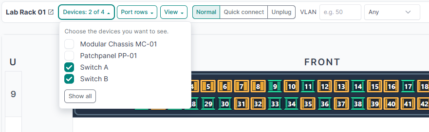
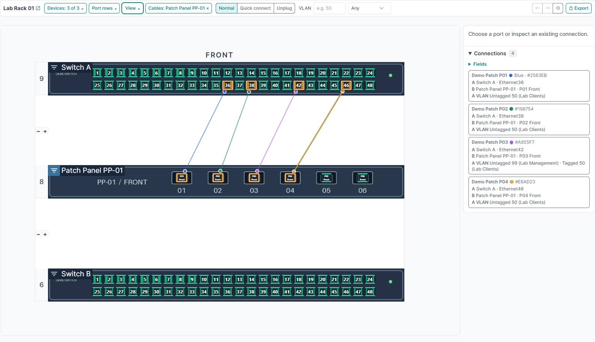
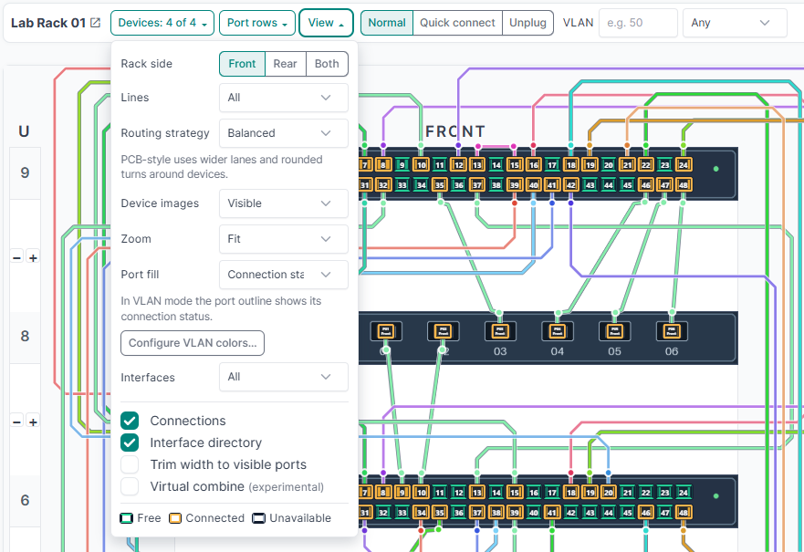
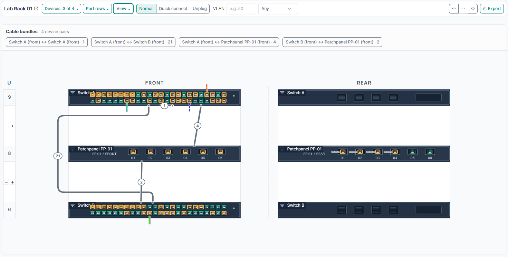
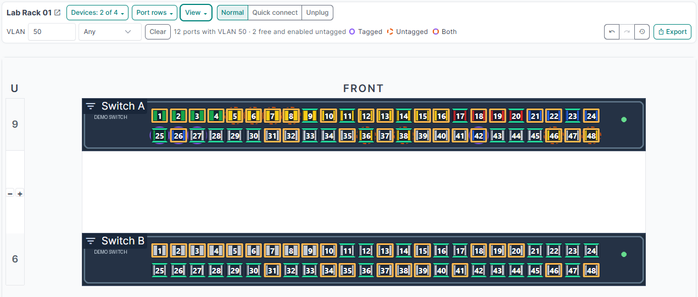
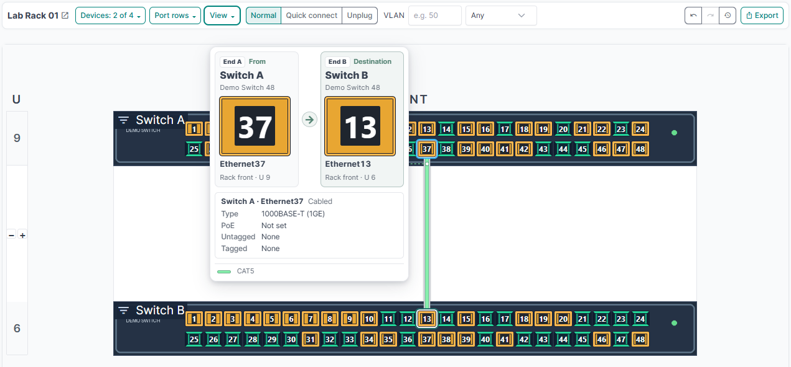
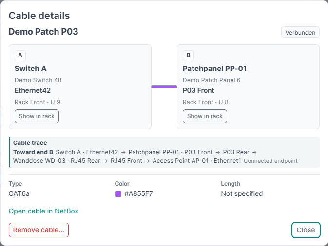
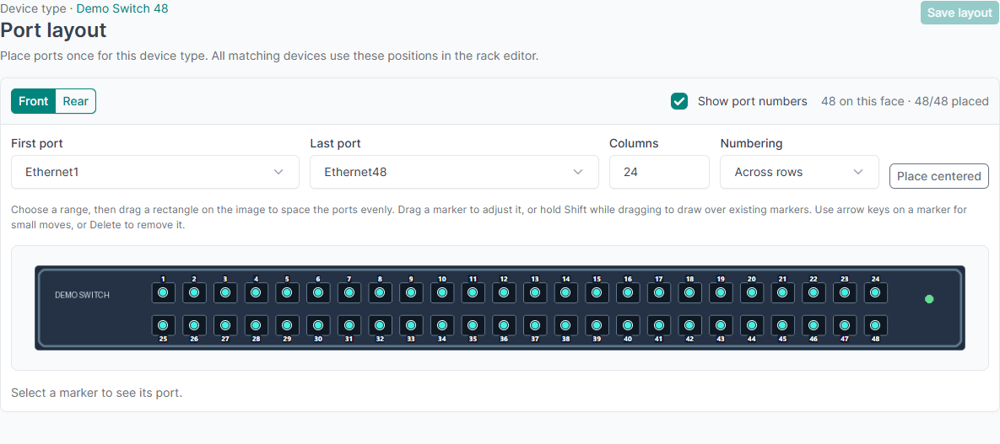

# nbCableEditor user guide

Use Cable Editor to find available ports, follow connections, and plan or record changes in NetBox. This guide uses **Lab Rack 01** from the [local Docker demo](../README.md#local-docker-demo). The same controls apply to other racks.

- [Open the editor](#open-the-editor)
- [Filter devices, rows, and cables](#filter-devices-rows-and-cables)
- [Choose the rack view](#choose-the-rack-view)
- [Find ports by VLAN](#find-ports-by-vlan)
- [Inspect and change connections](#inspect-and-change-connections)
- [Export the rack plan](#export-the-rack-plan)
- [Design a device or module layout](#design-a-device-or-module-layout)
- [Saved settings and troubleshooting](#saved-settings-and-troubleshooting)

## Open the editor

1. Open a rack in NetBox and select **Cable Editor**.
2. Start with **View → Rack side → Front** and **Zoom → Auto** to see as much of the front elevation as the workspace allows. Select **Rear** for rear-mounted ports or **Both** to work across the two sides.
3. Hover a port to identify it. Green double lines indicate a free port, an amber frame indicates a connected port, and a gray frame indicates an unavailable port. A VLAN fill can change the color inside the frame.

Available devices, ports, and actions depend on your [NetBox permissions](installation.md#permissions). A device can appear in the **Interface directory** even when its ports have no positions on the elevation.

## Filter devices, rows, and cables

| Control | What it changes | How to clear it |
| --- | --- | --- |
| **Devices** | Tick one or more devices to show those devices and their ports. With no device selected, the rack shows all devices. | Select **Show all**. |
| **Port rows** | Tick rows to show their ports on the elevation. The menu groups rows by device and rack side. **Only** keeps that row visible for its device and side. | Tick individual rows again or select **All rows**. |
| Filter icon beside a device name | Focuses cable display on direct connections to or from that device. Unrelated occupied ports are dimmed so the matching endpoints and free ports stand out. | Select the **Cables** chip in the toolbar. |
| **VLAN** | Highlights matching ports on the rack and narrows the side lists to VLAN matches. | Select **Clear** beside the VLAN selector. |
| **Interface directory → Search devices or interfaces** | Narrows the directory by device, port name, label, description, or cable peer. **Only ports outside the elevations** narrows it to ports that have no marker in the current elevations. | Clear the search and uncheck the option. |

**To inspect the PP-01 patch panel**, click its filter icon while keeping its peer devices visible. Use **Devices** to narrow the drawing further, then hover a connected port to identify the peer. A peer outside the current view can still appear in the tooltip when its details are available.

Device cable focus shows all matching cables in the current view or shows them as bundles. Clear the **Cables** chip to choose **Selected only** or **Hidden** again. To find a missing port, check the rack side, **Devices**, and **Port rows** first. Use the directory to find ports without a placed marker.

## Choose the rack view

Open **View** in the rack toolbar. The table shows the built-in defaults. Your NetBox administrator can set different starting values.

| Setting | Default | When to change it |
| --- | --- | --- |
| **Rack side** | **Front** | Choose **Rear** for rear patch ports or **Both** to see both elevations side by side. |
| **Lines** | **All** | Choose **Bundles** for an overview by device pair, **Selected only** to trace one chosen connection, or **Hidden** to hide persistent cable lines. Hover still lets you inspect a visible connected port. |
| **Routing strategy** | **Balanced** | Choose **PCB-style** for wider lanes and rounded turns. Expanded cable bundles use PCB-style automatically. |
| **Device images** | **Visible** | Use **50% opacity** or **Hidden** when the image makes ports or cables hard to see. Ports remain interactive. Press **I** while dragging a cable to cycle the image mode. |
| **Port fill** | **Connection status** | Choose **Untagged VLAN** to color the port interior by VLAN and read connection status from the outline. |
| **Interfaces** | **All** | Choose **Highlight Free** or **Highlight Used** to emphasize ports by connection status. |
| **Connections** and **Interface directory** | Both visible | Hide either panel in **View** to simplify the workspace. Hide both for more drawing space. |
| **Trim width to visible ports** | Off | Crop the unused left and right margins to a shared width based on the visible port positions. |
| **Virtual combine** | Off | Try narrow sleeves for runs of at least three cables between adjacent ports connected in the same order. |

Use **Zoom** in the rack toolbar to change the drawing scale. **Auto** uses the largest scale that fits both the available width and height. **Horizontal Fit** uses the available width, and **Vertical Fit** uses the available height. Fit modes scale down to 25%, so large racks may still require scrolling. For a fixed scale, choose **50%**, **75%**, **100%**, **125%**, **150%**, **175%**, **200%**, **250%**, or **300%**.

- Use the **mouse wheel** over the drawing to zoom around the pointer. Drag empty space or drag with the **middle mouse button** to pan. You can also use the rack scrollbars.
- On a touch screen, **pinch with two fingers** to zoom around their midpoint. Drag empty space with one finger to pan, or start on a port to connect or move a cable.
- The toolbar shows your custom zoom percentage. Choose a preset to switch back to that zoom strategy. Your zoom is saved in this browser.

Use **View → Use global defaults** to clear your saved view and list columns. For the current rack, this also clears your side override. Your VLAN color rules, device selection and rack filters are preserved.

### Read dense wiring

- Choose **Lines → Bundles** to see cable counts grouped by device pair and rack side. Select a bundle in the drawing or in the **Cable bundles** panel to expand it. Select **Show all bundles** to return to the overview.
- Use the small **+** and **−** controls between devices to adjust the display gap and make room for cable lanes. The rack positions in NetBox stay the same.
- Enable **Virtual combine** to try sleeves along eligible vertical or horizontal runs. The router searches for a clear stretch with space around other cables. Hover a sleeve to reveal all member cables inside its outline. Hover an individual cable or connected port to follow that link.

## Configure the plugin

Open **Cable Editor → Settings** in the NetBox sidebar, or **View → Plugin settings** inside a rack. This page requires [permission to change the plugin settings](installation.md#permissions).

- **View defaults** sets the rack side, zoom, line mode, routing strategy, device images, port fill and highlighting, and which view options start enabled. Browser preferences override these starting values.
- **Drawing** sets the target spacing between cables, devices and virtual tubes, and the starting gap and **+** / **−** step between devices. The router adapts its path to the space available.
- **Ports and hover** sets the maximum port contour width and optional widths for free, connected and unavailable ports. Port contours scale down on small markers. The hover delay is set in milliseconds.
- **Displayed fields** sets the starting columns in the Interface Directory and Connections and the fields shown on opening Cable Details and Port Details. Editable fields can still be reached through the corresponding **More properties** section. Select visible NetBox Cable custom fields here to show their values in Cable Details.

Save the settings and reload the rack to see the changes.

### Review built-in templates for existing device types

Open **Cable Editor → Layout template import**. Search by manufacturer, model or part number. The overview suggests a built-in template when it finds an unambiguous part number or model match. You can also select another template manually and preview the available faces.

Choose **Review mapping** to open the designer with that template. Check the mapping to your interface names, front and rear ports and module bays. If a layout already exists, check the replacement options before applying. Finish with **Save layout** in the designer.

## Find ports by VLAN

1. Enter a VLAN ID from **1** to **4094** in the toolbar, for example `50`.
2. Choose **Any**, **Tagged**, or **Untagged**. Tagged matches VLANs explicitly assigned to the port. The drawing marks matching ports, **Interface directory** lists those ports, and **Connections** lists cables with a matching endpoint in scope. In **All** line mode, the ordinary cable lines stay visible.
3. To find a place to connect a client, choose **Untagged** and look for a free, enabled match. The status beside the filter shows the count. **View → Interfaces → Highlight Free** makes free ports easier to pick out.
4. Hover or double-click a candidate to check its VLAN assignments, interface type, and PoE details. The editor displays the assignments recorded in NetBox.

### Set VLAN colors

Use **View → Port fill → Untagged VLAN**, then **Configure VLAN colors…**. Add a rule with a single ID, a comma-separated list such as `50,60,70`, or a range such as `50-70`. Choose the color and save. The first matching rule wins, followed by the VLAN's **Cable Editor color** and then the optional fallback. Ports without an untagged VLAN use a neutral fill. [Configure VLAN colors](installation.md#configure-vlan-colors)

VLAN color rules affect the port fill in your browser. Use the VLAN search to highlight tagged membership. To change a port's VLAN assignment, edit the interface in NetBox.

## Inspect and change connections

### Follow a port or cable

Hover a connected port to read **From → Destination**, with the hovered port first. When you hover a cable, its nearer end comes first. Both cards show the enlarged port label and keep their physical **End A** and **End B** identifiers. When the path continues through a patch panel, the arrow shows the immediate peer and the trace below shows the further destination, if visible to your account.

- Click or hover a **Connections** entry to highlight its cable in the drawing. The list shows endpoints and color. Use **Fields** to add details such as VLANs, type, status, and length.
- Use **Interface directory** for ports on or outside the elevations. It shows the connected peer and cable color when available. Use **Fields** to add peer VLANs, label, type, or description.
- Double-click a port or use **Port details** from its context menu to see port metadata and links to the native NetBox port, device, and connection. With change permission, you can edit the label and tags.
- Click a cable to open its details. A trace can follow NetBox front-to-rear mappings through a patch panel and a wall outlet. A stop marked **Unpatched** indicates an open end. With change permission, edit cable color, length, label, description, tags, and comments in the dialog. Text fields save on blur or **Enter**, comments save with **Ctrl+Enter**, and color and tag changes save when selected.
- Use the cable's right-click menu and choose **Edit cable…** to change its type or status.

### Connect, move, or remove cables

| Task | Steps |
| --- | --- |
| Connect two ports | In **Normal** mode, drag from a free port to a free target. Choose cable type, color, label, and optionally a length and unit. The dialog prefills the last saved type and color. Press **Enter** to confirm. |
| Connect outside the view | Double-click a free port and choose **Manual Connect**. NetBox opens its native cable form with side A preselected. Search for the destination on side B, including devices outside the rack, then save or cancel to return to the editor. |
| Move one end | Drag the connected port or its cable handle onto a free target and confirm. The existing cable keeps its ID and metadata. |
| Remove a connection | Open the cable details and choose **Remove cable…**, or use the cable's right-click menu. |
| Change several connections | Select **Quick connect** and click a source followed by a highlighted target to stage each pair, or select **Unplug** and click connected ports to stage removals. Choose **Apply batch** to save or **Discard** to clear the queue. |
| Restore earlier changes | Use **Undo**, **Redo**, or choose a checkpoint in **History**. History covers cable changes saved through Cable Editor and is scoped to your account and rack. A concurrent change to the same cable can prevent a restore. |

The editor draws and directly edits one-to-one cables between interfaces, front ports, and rear ports in the same rack. NetBox permissions govern which actions are available.

## Export the rack plan

1. Set the rack sides, devices, rows, and line mode you want to include. If you want individual links in the plan, choose **All** or expand the bundle before exporting.
2. Select **Export**. For **PNG image**, choose the longest side or enter a custom value from 320 to 6000 pixels. The whole drawing is exported at its current aspect ratio.
3. For **Print / Save as PDF**, choose paper size and orientation. Enable **Include cable list** to list the drawn cables or bundles that match the current **Connections** filters. The list is grouped by endpoint devices, with reference numbers linking the rows to the plan. Choose your printer or **Save as PDF** in the browser print dialog.

The print layout spaces routes more widely than the on-screen drawing. Use the preview to check that the rack and cable list fit the chosen page size.

## Design a device or module layout

1. Create the port templates on the NetBox **Device Type** or **Module Type**. Use **Front Port Templates** and **Rear Port Templates** for passive jacks. Open **Layout editor** and choose **Front** or **Rear**.
2. Use **Use type image** to choose the background on each face. Add custom artwork with **Text** or **Rectangle**. Set font, size, and color. A rectangle can have a fill and a label integrated in its frame or centered within it.
3. Use **Single port** to place one port. For a range, select **Port grid**, choose the **First port** and **Last port**, then set the row and column counts and labels. Under **Port order**, choose one of the eight numbered diagrams. Each starting corner supports placement across rows or along columns. The arrow indicates the direction within a row or column, and the dashed line leads to the start of the next one. Drag the grid onto the drawing or use **Place centered**. For example, 48 ports can use 2 rows and 24 columns. **Displayed port label** sets the rack label for all instances of the type.
4. Use **Field → Insert** to add a device, module, or accessible custom field to a text item or rectangle label. The preview uses sample values. The rack renders the actual values available to the viewer.
5. Draw a **Module bay** region for a bay template on a device type. An installed module's artwork and ports appear in that region. For module type images, add NetBox image attachments named `Front` and `Rear`.
6. Choose **Save layout** to apply the design to instances of that type. Unplaced ports remain accessible from the directory.

Use **Select** to drag a selection box. Hold **Shift** to extend the selection or **Ctrl**/**⌘**-click to toggle individual ports. Use **Align** for a row, column, or grid, and **Snap → Grid** or **Objects** for alignment guides. Hold **Alt** while dragging to bypass snapping. **Undo** and **Redo** cover both faces of the current editing session.

### Import a layout template

1. Open **Layout editor → Import template** on the device type or module type. Choose a built-in template or open a **JSON file** for the corresponding type. Select **Front** or **Rear** when the file includes both faces.
2. Review the mapping. By default, slot `24` matches a port of the same kind named `24`, then falls back to a matching label. For names such as `Ethernet24` or `1/1/24`, enter `Ethernet{port}` or `1/1/{port}` in the name pattern field and choose **Remap**. On a patch panel, the front and rear slots map to NetBox **Front Port Templates** and **Rear Port Templates**, respectively. Correct any missing or ambiguous matches using the selectors.
3. For a 5406R, map the front slots **A–F** and the rear slots **PSU1** and **PSU2** to your NetBox **Module Bay Templates**. Matching bay names are selected automatically. Installed line cards use their Module Type's front layout. The J9829A power supply uses its rear layout.
4. Choose **Apply to canvas**. The selected face uses the template artwork with its image disabled. The import moves mapped interfaces and bays to their slots and keeps other placements. Use **Undo** to revert the import or **Save layout** to keep it.

#### Built-in templates

Each JSON file contains front and rear artwork and links to the hardware references. Check the product number when similar models have different ports or power configurations.

| Template | Product number |
| --- | --- |
| [Aruba 2530-24-PoE+-2SFP](../nbcableeditor/static/nbcableeditor/layout-templates/aruba-2530-24-poe-2sfp.json) | J9779A |
| [Aruba 2540 48G 4SFP+](../nbcableeditor/static/nbcableeditor/layout-templates/aruba-2540-48g-4sfp-plus.json) | JL355A |
| [Aruba 2920-24G](../nbcableeditor/static/nbcableeditor/layout-templates/aruba-2920-24g.json) | J9726A |
| [Aruba 2920-48G](../nbcableeditor/static/nbcableeditor/layout-templates/aruba-2920-48g.json) | J9728A |
| [Aruba 2930F-24G-PoE+-4SFP+](../nbcableeditor/static/nbcableeditor/layout-templates/aruba-2930f-24g-poe-4sfp-plus.json) | JL255A |
| [Aruba 2930F-48G-4SFP+](../nbcableeditor/static/nbcableeditor/layout-templates/aruba-2930f-48g-4sfp-plus.json) | JL254A |
| [Aruba 5406R zl2 J9821A](../nbcableeditor/static/nbcableeditor/layout-templates/aruba-5406r-zl2-j9821a.json) | J9821A switch kit |
| [Aruba 5406R zl2 J9850A](../nbcableeditor/static/nbcableeditor/layout-templates/aruba-5406r-zl2-j9850a.json) | J9850A base chassis |
| [Aruba 6000-12G-POE4-2SFP](../nbcableeditor/static/nbcableeditor/layout-templates/aruba-6000-12g-poe4-2sfp.json) | R8N89A, with two additional gigabit copper ports |
| [Aruba 6100-48G-4SFP+](../nbcableeditor/static/nbcableeditor/layout-templates/aruba-6100-48g-4sfp-plus.json) | JL676A |
| [Aruba 6100-48G-POE4-4SFP+](../nbcableeditor/static/nbcableeditor/layout-templates/aruba-6100-48g-poe4-4sfp-plus.json) | JL675A, 370 W PoE budget |
| [Aruba 8320-48XF6Q](../nbcableeditor/static/nbcableeditor/layout-templates/aruba-8320-48xf6q.json) | JL479A |
| [ProCurve 2810-48G](../nbcableeditor/static/nbcableeditor/layout-templates/procurve-2810-48g.json) | J9022A |
| [24 Port Unmanaged Switch](../nbcableeditor/static/nbcableeditor/layout-templates/generic-24-port-unmanaged-switch.json) | Generic, 24 interfaces |
| [24-port UTP Patch Panel](../nbcableeditor/static/nbcableeditor/layout-templates/generic-24-port-utp-patch-panel.json) | Generic, 24 pass-through positions |
| [LC-12-port Fiber Patch Panel](../nbcableeditor/static/nbcableeditor/layout-templates/generic-lc-12-port-fiber-patch-panel.json) | Generic, 12 pass-through positions |
| [LC-24-port Fiber Patch Panel](../nbcableeditor/static/nbcableeditor/layout-templates/generic-lc-24-port-fiber-patch-panel.json) | Generic, 24 pass-through positions |
| [SC-24-double-port Fiber Patch Panel](../nbcableeditor/static/nbcableeditor/layout-templates/generic-sc-24-double-port-fiber-patch-panel.json) | Generic, 24 duplex adapters |

The 2920 and 2810 use shared logical port numbers for their dual-personality connectors. Each logical port has one assignable position at the copper connector. The alternate SFP cages are drawn as artwork.

The SC schematic uses one logical slot for each pair of openings. To trace across any patch panel, configure the front-to-rear port mappings in NetBox.

| Module template | Visible face | Assignable ports |
| --- | --- | --- |
| [HP J9537A 24-port SFP v2 zl](../nbcableeditor/static/nbcableeditor/layout-templates/hp-j9537a.json) | Front | 1–24 |
| [HP J9548A 20-port Gig-T / 2-port SFP+ v2 zl](../nbcableeditor/static/nbcableeditor/layout-templates/hp-j9548a.json) | Front | Copper 1–20, SFP+ 21–22 |
| [HP J9538A 8-port 10GbE SFP+ v2 zl](../nbcableeditor/static/nbcableeditor/layout-templates/hp-j9538a.json) | Front | 1–8 |
| [Aruba J9829A 1100 W power supply](../nbcableeditor/static/nbcableeditor/layout-templates/aruba-j9829a.json) | Rear | Artwork for the AC inlet |

#### Add a built-in template

1. Save the JSON under `nbcableeditor/static/nbcableeditor/layout-templates/` and validate it against the [JSON Schema](../nbcableeditor/static/nbcableeditor/layout-templates/layout-template.schema.json). Use `schemaVersion: 1`, a `kind` of `device` or `module`, and one or both `faces`. Define image-free `items` with text or rectangles. Coordinates run from `0` to `1` across each face.
2. Give each slot a name that can match an existing NetBox component. A port defaults to `kind: "interface"`. Use `"front-port"` or `"rear-port"` for a passive slot on the matching face. The optional port `label` controls the displayed label. For `bays`, `moduleFace` selects the installed module face and defaults to the imported face. Use installation-independent names and keep NetBox IDs out of the JSON.
3. The built-in catalog discovers assets in that directory. Add the model and any variant assumptions to the list above. Verify the asset with `node --test tests/layout-template.test.cjs` and preview it through **Import template**. Check port counts, label placement, and that **Undo** restores the previous drawing.

For Codex in this checkout, use `$create-template-for-device-type` or `$create-template-for-module`. The project also recognizes `/createTemplateForDeviceType <model>` and `/createTemplateForModule <model>` as prompt aliases. [Project commands](../AGENTS.md)

## Saved settings and troubleshooting

- **Shared across racks in this browser.** Zoom, line mode, routing strategy, images, panel visibility and open state, list fields, VLAN color rules, trim, and other display options use browser storage.
- **Saved separately for each rack.** Rack side, selected devices and rows, device cable focus, VLAN filter, directory search, and display gaps use browser storage. The URL carries the active side, device, row, cable-focus, and VLAN filters so you can copy a link to that selection. The recipient's own display settings still apply.
- **A cable is missing.** Clear the **Cables** chip and VLAN filter, restore the devices and rows, select the relevant rack side, and choose **View → Lines → All**. Check the **Connections** list for a peer outside the elevation.
- **A device image or port is missing.** Select **Device images → Visible**, check the rack side and port rows, then inspect the device or module type's layout. A port without coordinates can still be found in the directory.
- **An edit action is unavailable.** Ask your NetBox administrator to verify the required [object permissions](installation.md#permissions) for the affected cables, devices, ports, or layouts.
